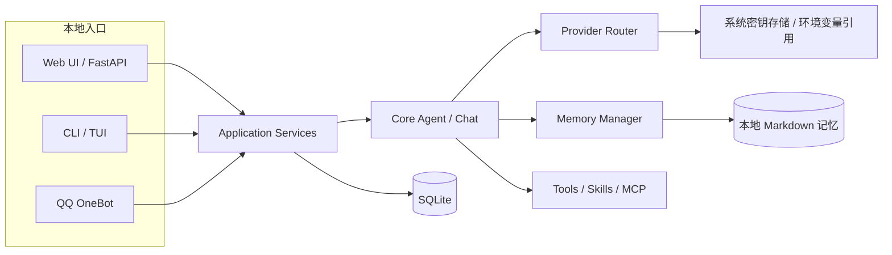

# 星栖 V1.3 技术设计：M0 现状审计与技术基线

审计日期：2026-10-10  
审计范围：当前仓库代码、README、CI 配置和相关自动化测试文件  
文档类型：独立技术设计文档；PRD 仍是需求来源，本文件不替代或改写 PRD。  
M0 目的：为 V1.3 本地单用户版本建立可追溯的实现基线；本阶段只审计和记录技术决策，不修改产品代码。

## 1. 结论摘要

V1.3 与仓库当前的本地个人 Agent 方向一致。项目已有本机 Web/API、Provider 管理、多智能体、流式聊天、长短期记忆、CLI、QQ、Skills/MCP 和本地 API 安全边界。本版应在现有能力上补齐缺口，不需要重建核心 Agent。

M0 发现三个影响后续实现的主要差距：

1. **角色之间共享用户信息尚未实现。** 当前每个自建 Agent 有独立 Identity 和 Markdown 记忆工作区，且自建 Agent 记忆不允许标记为共享。
2. **角色删除策略与 V1.3 决定相反。** 当前只要角色还有会话、记忆、记忆任务或 MCP 配置，删除就会被拒绝；用户已确认改为删除角色时同时删除关联数据。
3. **Web 聊天缺少会话内模型切换。** Provider 可配置、测试和设置全局默认值，角色也可设置默认模型；聊天页显示当前模型，但发送请求未携带模型选择。

其余优先差距包括：记忆自动保存的关闭入口、头像上传、角色字段细化、角色删除的完整数据清理、渠道范围的验收定义及可供用户操作的完整备份恢复流程。

## 1.1 当前架构基线

当前入口复用 Application/ChatService；数据由本机 SQLite、Markdown 记忆目录和系统密钥存储组成。Web 可选择 Agent，CLI/QQ 当前沿用默认助手。所有 `/api` 路由仍受本机访问边界约束。

## 1.2 M0 工作内容与产物

M0 的工程产物仅包括：

1. 本文中的当前架构与 PRD 需求差距表。
2. 对共享记忆、角色删除、模型切换、本地模型连接和渠道行为的技术风险记录。
3. M1 开始前需补充的验收口径，以及后续需要设计的迁移与回滚事项。

本阶段不新增 API、数据库字段、配置项或 UI，也不运行测试。审计结论依据静态代码、已有测试文件和 CI 配置；已有测试文件仅说明仓库中存在相关验证用例，不代表本轮已验证通过。

## 2. 本轮已确认的产品约束

- 单人、本地优先；默认仅绑定回环地址，不增加账号或公网多租户能力。
- Web 是主要界面；CLI 和现有 QQ 入口继续使用默认助手，暂不增加渠道中的多角色选择。
- 用户事实和偏好跨角色共享；角色专属的共同经历和关系状态仍按角色隔离。
- 首版暂不新增 Agent 工具能力。已有工具、Skills/MCP 保持现状，不作为本轮新增功能验收项。
- Provider 支持用户配置本机及局域网推理服务地址；云端模型上下文传输提示仍需保留。
- 删除角色时删除其会话、记忆和其他角色专属数据；共享用户资料不因删除任一角色而删除。
- 保留现有可用功能和数据；数据库变更必须通过 Alembic Migration，不要求删除数据库。

## 3. 审计判定口径

- **已有**：当前代码存在对应实现；该标记不代表本次重新运行测试或确认其在所有真实环境下均通过。
- **部分实现**：已有相关底层能力，但缺少 PRD 所需 UI、边界行为、验证或完整数据处理。
- **未实现**：在当前代码/UI 中未找到对应能力。
- **暂不开发**：按本轮产品确认不属于本轮新增范围；已有能力不因此删除。

测试文件只作为代码库中的验证覆盖依据。本轮未运行测试，不能据此报告测试通过。

## 4. 按 PRD 模块盘点

| PRD 模块 | 状态 | 当前实现与依据 | 差距 / 风险 |
|---|---|---|---|
| F01 本地运行与数据保存 | 部分实现 | `zhiyu serve` 默认监听 `127.0.0.1`；数据目录可配置，默认 SQLite 与 Markdown；API 校验回环 peer、Host、跨源写入和请求标记。见 `src/zhiyu/cli/main.py`、`src/zhiyu/api/app.py`、`src/zhiyu/infrastructure/config/settings.py`。 | 迁移前会备份数据库和记忆目录，但没有面向用户的完整数据备份/恢复流程。状态页与诊断已有基础；安装、更新体验不属于当前核心缺口。相关覆盖见 `tests/test_web_api.py`、`tests/test_migrations.py`。 |
| F02 模型管理与切换 | 部分实现 | Provider 支持多种供应商、API Key 密钥存储、Base URL、连接测试、模型能力、全局默认和故障切换。会话保存 `model_id`；CLI 可按会话指定模型；聊天请求 API 支持传 Provider/模型。见 `src/zhiyu/application/providers.py`、`src/zhiyu/core/providers/selection.py`、`src/zhiyu/api/routes/providers.py`。 | Web 聊天页只有模型标识，没有会话内切换控件，`useChatSession` 发起聊天时未提交 provider/model。OpenAI 兼容 Provider 支持自定义 Base URL，但仓库测试主要覆盖协议/请求行为，未证明与特定本地推理程序的真实互通。密钥由系统密钥存储或环境变量引用管理，UI 不回显。 |
| F03 角色创建与管理 | 部分实现 | Web 支持创建、编辑、选择多个 Agent；字段包含名称、简介、性格、背景、说话风格、自定义系统指令、角色默认模型；会话和记忆按 Agent 隔离。见 `src/zhiyu/application/characters.py`、`src/zhiyu/api/routes/agent.py`、`web/src/pages/AgentsPage.tsx`。 | 数据库虽有 `avatar` 字段，但当前角色表单/API 未实现头像上传；开场白、初始场景、行为偏好等没有独立字段，可部分塞入系统指令但无法单独编辑/验收。角色删除仍采用“有关联数据时拒绝删除”。 |
| F04 聊天与上下文 | 部分实现 | 后端有流式响应、会话历史、持久化消息、取消运行、模型能力检查和可见错误；前端能显示工具/运行状态。见 `src/zhiyu/application/chat.py`、`src/zhiyu/api/routes/agent.py`、`web/src/hooks/useChatSession.ts`。 | Web 有失败反馈，但缺少明确的“重试这条消息”闭环；当前模型切换问题见 F02。已有会话不能直接换角色，改角色需新建会话，这与“角色切换”应被解释为切换当前活动会话/角色，而非改挂既有会话。 |
| F05 长期记忆 | 部分实现 | 支持后台提取、手动添加、搜索、修改、删除/遗忘、来源追踪、记忆修订、Markdown 与 SQLite 索引同步。见 `src/zhiyu/core/memory/`、`src/zhiyu/application/memories.py`、`src/zhiyu/application/memory_lifecycle.py`。 | 自建 Agent 的记忆完全按 Agent 隔离；`MemoryRepository.create` 对 Agent `shared=True` 明确报错。跨角色共享用户事实/偏好尚未实现。Web 未找到关闭自动记忆的用户开关。用户资料文件当前按 Identity 工作区保存，因此直接复用会继续产生角色隔离。历史记忆的自动分类/迁移需防止将角色剧情误合并为用户事实。 |
| F06 Agent 工具、Skills 与 MCP | 暂不新增 | 当前已有内置工具、Skills 和 MCP；Web 可配置 MCP 工具授权、按 Agent 管理插件。默认 MCP 工具权限为空。见 `src/zhiyu/core/tools/`、`src/zhiyu/application/mcp.py`、`src/zhiyu/application/skills.py`、`web/src/pages/McpPage.tsx`。 | 按本轮确认，不新增工具能力或扩展权限系统，也不将工具执行列入本轮验收；需维持当前能力和安全默认值。V1.3 表格/ F06 中的 P0“使用和管理已有能力”应改写为“保留现有能力，不扩展”。 |
| F07 多渠道 | 部分实现 | CLI、Web、QQ 使用共享的 `ChatService`/Agent 核心；QQ 有主人权限、群聊白名单、@ 规则、Token、去重和事件恢复路径。见 `src/zhiyu/application/chat.py`、`src/zhiyu/application/runtime.py`、`src/zhiyu/channels/`、`tests/test_channels.py`。 | CLI 和 QQ 沿用默认助手；Web 可选多个 Agent。验收应明确“渠道均可继续使用默认助手并读取共享用户资料”，而不是要求跨渠道选同一个自建角色或共享会话记录。渠道会话历史仍按渠道隔离。 |
| F08 主动消息与定时任务 | 未实现 / P1 | 当前仓库没有可用的用户级提醒任务闭环；迁移 `0023_multi_agent` 已删除此前的 `standing_intents` 表。 | 可保持 P1，不阻塞本地聊天首版。未来实现时需明确进程关闭、休眠时的跳过/补发规则。 |
| F09 形象与多模态 | 部分实现 | 模型能力结构包含流式和视觉标记；QQ 图片有支持路径；角色表有头像字段。 | Web 角色头像上传未实现；图片理解/语音应依 PRD 列为后续能力，不能因底层消息类型存在就标为 Web 已交付。 |
| 数据与安全 | 部分实现 | API 本机边界、密钥存储、MCP 显式工具授权、Memory 身份隔离和 Alembic 迁移已有实现。见 `src/zhiyu/api/app.py`、`src/zhiyu/infrastructure/config/keystore.py`、`src/zhiyu/core/memory/mutations.py`。 | 角色级级联删除必须同步处理 SQL 关联和 Markdown 记忆文件/索引，不能仅依赖数据库 `ON DELETE`。备份目前以迁移前备份为主，缺少用户主动备份与恢复的端到端流程。 |

## 5. 关键实现现状与差距

### 5.1 共享用户资料与角色私有记忆

当前 `IdentityRepository.for_agent()` 为每个角色创建独立 Identity。`MemoryStore` 将 Markdown 文件写入 `memory/identities/<identity_id>/`，检索、遗忘、索引恢复也按 Identity 限定。测试 `tests/test_multi_agent.py::test_blank_workspaces_and_memory_lifecycle` 和 `test_extraction_tools_and_consolidation_keep_agent_scope` 明确验证角色之间不可见。

因此 V1.3 不是简单把现有“角色隔离”关掉，而是要形成两种记忆范围：

1. **共享用户资料**：经确认的用户事实和偏好，所有角色可读取、可查看修改删除。
2. **角色专属记忆**：该角色关系状态、共同经历及角色对话情节，仅对应角色读取。

后续设计应先明确写入、检索、更新、遗忘和导出路径如何区分这两类数据，再决定复用共享 Identity 还是建立独立用户资料工作区。不得把所有旧 Agent 记忆无差别合并。建议迁移策略：可明确识别为用户资料/偏好的记录才自动进入共享范围；语义不确定的旧记忆保留在原角色工作区。

### 5.2 删除角色及其关联数据

当前 `CharacterService.delete()` 在存在 Conversation、Memory、MemoryJob 或 MCP 配置时拒绝删除；Web UI 也提示先手动清理。已有测试 `tests/test_multi_agent.py::test_existing_session_cannot_change_agent_and_delete_is_protected` 锁定了这个行为。V1.3 已明确改变该行为。

级联删除设计至少要盘点：角色、Identity、会话、消息、会话摘要、AgentRun/步骤、记忆、记忆来源/召回/嵌入/记忆任务/整合记录、角色记忆目录及其文件索引、MCP 配置与 Secret 引用、Skills 角色关联。共享用户资料不能删除；消息被记忆来源引用时需按既有遗忘与来源一致性机制处理。

因为 Memory 正文在 Markdown、索引和状态在 SQLite，数据库事务无法让文件系统删除自动具备原子性。实施时应复用现有 Memory mutation/recovery 机制，设计可恢复的删除顺序和重启后清理行为；不可只增加 ORM cascade 后直接删角色。

### 5.3 本机与局域网推理地址

`OpenAICompatibleProvider` 允许使用自定义 `base_url`，请求路径为 `<base_url>/chat/completions`，并设置 `trust_env=False`。Provider 配置 UI/API 已支持 Base URL。

本机或局域网服务可以作为兼容 Provider 使用；但 M0 没有真实运行 llama.cpp、Ollama 或其他本地服务进行端到端兼容验证。后续 P0 验收应选择至少一种用户实际使用的兼容服务，定义 Base URL 应包含的路径形式、连接测试反馈和无 Key 服务如何配置，而不是笼统承诺“兼容本地推理”。

### 5.4 Web 重试与模型选择

Provider API 的连接测试只验证 Provider 的测试请求，不等于聊天页模型切换已交付。当前 Web 聊天请求体只发送消息、会话 ID 和角色 ID。`Conversation.model_id` 可记录模型，但界面没有模型选择控件。因此后续应把“默认模型选择”和“当前会话覆盖”分开验收，并验证切换只影响后续请求。

当前 Web 在消息失败时可显示错误，但未发现显式重试按钮/动作。P0 实施前应决定重试是重发失败用户消息、重新生成助手回复，还是两者都支持；重试必须避免重复持久化用户消息。

## 6. 后续阶段建议

本节只给出阶段顺序和设计边界，不作为 M1–M3 的详细技术设计。各阶段实施前应另写独立技术设计文档，列出具体调用链、Schema/Migration、接口、权限、回滚及测试方案。

### M1：本地聊天闭环

- 补齐 Web 会话级模型切换，保留全局默认和角色默认优先级。
- 验证受支持的本机/局域网 OpenAI 兼容推理服务连接与错误反馈。
- 明确失败消息重试语义；完善角色编辑字段与头像的 P0 交互范围。
- 实现已确认的角色删除策略：删除角色及关联数据，保留共享用户资料；同步处理数据库与角色记忆文件。
- 以当前已有 Provider、聊天、角色模块为基础，只新增缺失部分。

### M2：共享用户信息与记忆管理

- 建立共享用户资料和角色私有记忆的双范围数据流。
- 调整 Memory 保存、检索、提取、合并、编辑、删除、清空、索引恢复和聊天上下文组装。
- 增加共享资料与角色记忆的可区分管理入口，以及关闭自动记忆的设置。
- 为历史记忆制定只迁移明确用户资料的规则；迁移需有 Alembic 版本、预迁移备份、恢复策略和临时数据测试。

### M3：现有渠道与数据维护验收

- 验收 Web、CLI、QQ 默认助手都可使用共享用户资料；渠道会话历史仍各自独立。
- 回归 QQ 主人权限、群聊白名单、@ 规则、Token、去重和恢复机制。
- 补齐面向用户的数据备份/恢复方案，并验证包含数据库、Markdown 记忆和必要配置；API Key/Secret 不应以明文进入导出包。
- 现有 Skills/MCP 保持兼容，不增加工具种类或扩大默认授权。

主动消息、语音/图片、角色模板和桌面应用按后续 P1/P2 规划推进，不作为上述核心闭环的前置条件。

## 7. 验收与验证要求

后续每个里程碑都应先补充或调整对应测试，再实现功能。至少覆盖：

- 两个角色共享同一条已确认用户偏好，但各自的共同经历和关系记忆不可互见。
- 修改/删除共享资料后，所有角色的后续检索都反映变更；清空单个角色记忆不删除共享资料。
- 删除有历史会话和记忆的角色后，其关联数据不可继续检索，其他角色和共享资料保持完整。
- 删除过程遇到文件系统异常或中断时，重启恢复不留下可被检索的孤儿数据。
- Web 切换模型只影响后续请求，历史消息、角色提示和记忆保持不变。
- 本机/局域网模型服务连接成功与典型失败状态可诊断。
- Web、CLI、QQ 的默认助手行为和 QQ 安全策略回归通过。
- 迁移从当前数据库版本升级后保留用户数据；不依赖删除数据库。

## 8. 现有验证基线

CI 在 Ubuntu、Windows、macOS 上运行 Python 测试、前端类型检查/测试/构建、CLI 帮助冒烟和 wheel 构建，见 `.github/workflows/ci.yml`。当前相关测试文件包括：

- 模型与密钥：`tests/test_provider_service.py`、`tests/test_providers.py`、`tests/test_web_api.py`
- 角色与范围：`tests/test_character_service.py`、`tests/test_multi_agent.py`
- 聊天：`tests/test_chat_service.py`、`tests/test_web_api.py`、`web/test/chatState.test.ts`
- 记忆：`tests/test_memory.py`、`tests/test_memory_lifecycle.py`、`tests/test_memory_vaults.py`、`tests/test_memory_retrieval_v2.py`
- 渠道/扩展：`tests/test_channels.py`、`tests/test_channel_pipeline.py`、`tests/test_mcp.py`、`tests/test_skills_lifecycle.py`
- 数据迁移：`tests/test_migrations.py`

本轮仅静态审阅上述实现与测试文件，未执行测试、构建或真实本地模型连接。CI 配置说明了自动化验证范围，不代表本地当前工作区的验证结果。

## 9. 文档与用户说明同步项

README 当前明确写着“每个智能体拥有独立记忆”，且默认助手的私人资料不会注入其他智能体；这与 V1.3 的跨角色共享用户信息目标不同。实现共享记忆后，应同步修订 README、界面文案和记忆数据说明。此处仅记录冲突，不在 M0 改动用户文档。

## 10. M0 完成标准

- V1.3 需求均有状态、代码依据和测试文件依据。
- 已识别共享记忆、角色删除和 Web 会话模型切换三个主要实现差距。
- 已记录共享/私有记忆边界、角色删除文件一致性、本地模型互通验证等设计风险。
- 未改产品代码、数据库或用户数据；未运行测试。
- M1 开始前，先为会话重试语义和头像是否纳入 P0 补充明确验收口径；其他不确定项不阻塞本审计结论。
